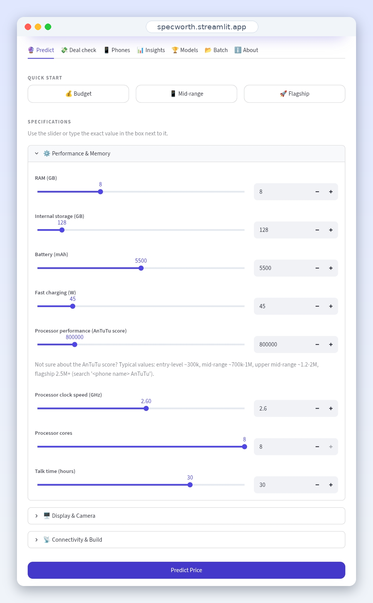
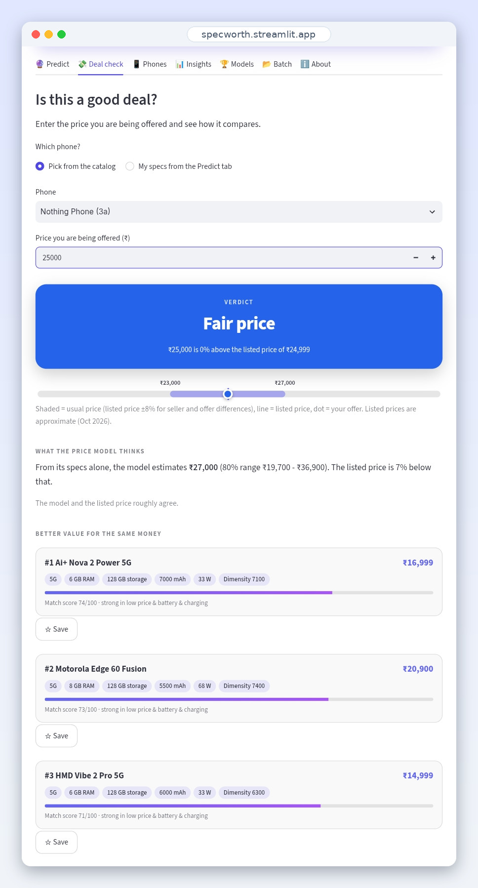
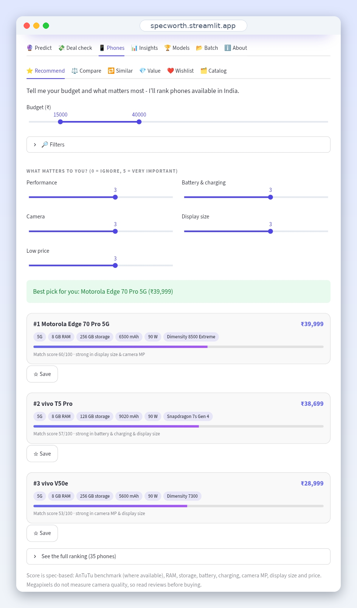
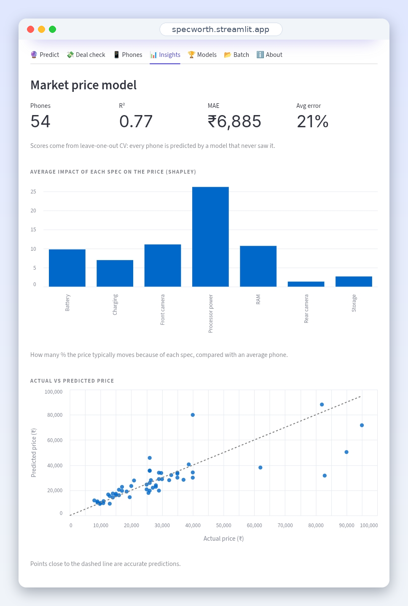
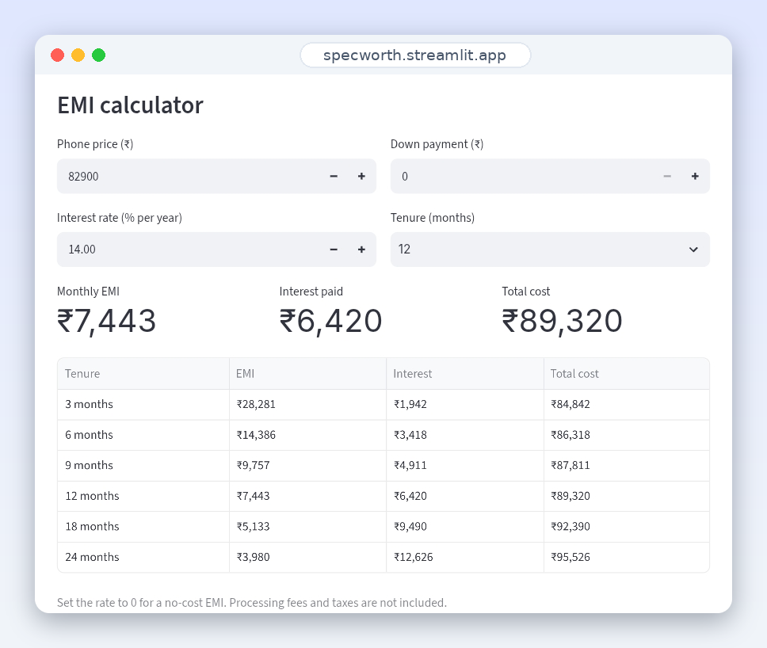

# SpecWorth

*Know what your phone is worth.*

[](https://specworth.streamlit.app/)


SpecWorth is a machine learning web app that estimates a smartphone's market price in India from its specifications, tells you whether an offer is a good deal, and recommends the best phones for your budget.

**Try it:** [specworth.streamlit.app](https://specworth.streamlit.app/)

<p align="center">
  
  
</p>
<p align="center">
  
  
</p>
<p align="center">
  
</p>

## Contents
[Features](#features) · [Two models](#two-models) · [Model performance](#model-performance) · [How it works](#how-it-works) · [Run locally](#run-locally) · [Project structure](#project-structure) · [Limitations](#limitations) · [Author](#author)

## Features

| Area | What it does |
|---|---|
| **Predict** | Price in ₹ from RAM, storage, battery, charging, cameras and AnTuTu score, with an 80% prediction interval, a Shapley explanation of every spec's effect, and a PDF report. Every spec has a slider and a number box, with ranges that match phones sold today |
| **Deal check** | Enter the price you are offered and get a verdict from *great deal* to *overpriced* on a visual gauge, better-value alternatives, and an EMI calculator |
| **Phones** | Budget and priority ranking with filters (brand, 5G, RAM, storage, battery), side-by-side comparison with PDF export, similar phones, value-for-money chart, wishlist, editable catalog |
| **Insights & Models** | Model card, Shapley importance, actual vs predicted plot, cross-validation, live GridSearchCV tuning for the classifiers |
| **Batch** | Upload a CSV to estimate prices or classify price segments in bulk |

## Two models

| Model | Data | Purpose |
|---|---|---|
| Gradient Boosting regression | `phones.csv`: 54 phones sold in India (approx. Oct 2026 prices) | Price in ₹ for modern phones |
| Logistic Regression classifier | Kaggle Mobile Price Classification: 2,000 phones, 4 price classes | Price segment, from my Winnovation ML training project |

The Kaggle dataset only has price classes (0-3) and older phones (RAM up to about 4 GB), so it cannot price a modern phone in ₹. The India catalog model does that, and the classifier is kept to show the full project.

## Model performance

Regression model on 54 phones:

| Evaluation | R² | Mean absolute error | Average error |
|---|---|---|---|
| Nested cross-validation (6-fold x 2, grid search inside each fold) | 0.75 | about ₹7,100 | about 24% |
| Leave-one-out score of the final tuned model (shown in the app) | 0.77 | about ₹6,900 | about 21% |
| Untuned baseline (leave-one-out) | 0.74 | about ₹7,300 | about 23% |

Nested CV is the honest estimate, since the hyperparameters were tuned on the same 54 phones and the leave-one-out score is therefore slightly optimistic. Tuning helped only a little: with this little data, the data is the limit rather than the algorithm.

**Prediction interval:** conformal prediction from out-of-sample residuals (80% target, 83% observed). Quantile regression was tried first but covered only 63% of phones, so it was not used.

**Classification models (80/20 split):** Logistic Regression 97.5%, Random Forest 89.25%, KNN 53%. The app can re-tune all three live.

## How it works
- **Features:** RAM, storage, battery, charging speed, rear and front camera, AnTuTu benchmark
- **Target:** log of the price, so errors are relative rather than absolute
- **Tuning:** GridSearchCV over trees, depth, learning rate, leaf size and subsampling
- **Explanations:** exact Shapley values over all 2^7 feature coalitions, rescaled to ₹ so they add up to the estimate
- **Persistence:** the trained model is saved with `joblib` (`market_model.joblib`); the app retrains automatically if the catalog or library version changes
- **Phone ranking:** a transparent spec-based score (AnTuTu, RAM, storage, battery, charging, camera MP, display size, price) weighted by the priorities you choose

## Run locally

```bash
pip install -r requirements.txt
streamlit run app.py
```

Needs `train.csv` (Kaggle Mobile Price Classification) and `phones.csv` in the same folder.

To update the catalog, retrain, and run the tests:

```bash
python train_models.py
pip install pytest
python -m pytest -q
```

## Project structure

```
app.py              Streamlit interface
core.py             Models, scoring, Shapley values, EMI and deal logic (no Streamlit, unit tested)
pdf_report.py       PDF reports (ReportLab)
train_models.py     GridSearchCV + nested CV; saves market_model.joblib and model_card.json
phones.csv          Phone catalog
train.csv           Kaggle dataset used by the classification model
test_core.py        24 unit tests
docs/               Screenshots
```

## Limitations
- The catalog is hand-collected from public listings. Prices vary by variant and seller, and sources sometimes disagree
- 54 phones is small, so estimates are indicative (about ±₹7,000) and brand premium, for example Apple, is not captured
- The 5G flag is derived from the chipset and model name
- The phone ranking is a spec-based score, not a review. Megapixels do not measure camera quality

## Tech stack
Python · Pandas · NumPy · scikit-learn · Altair · ReportLab · Streamlit · pytest · GitHub Actions

## Author
**Rishi Mishra** ·

## License
MIT, see [LICENSE](LICENSE).
